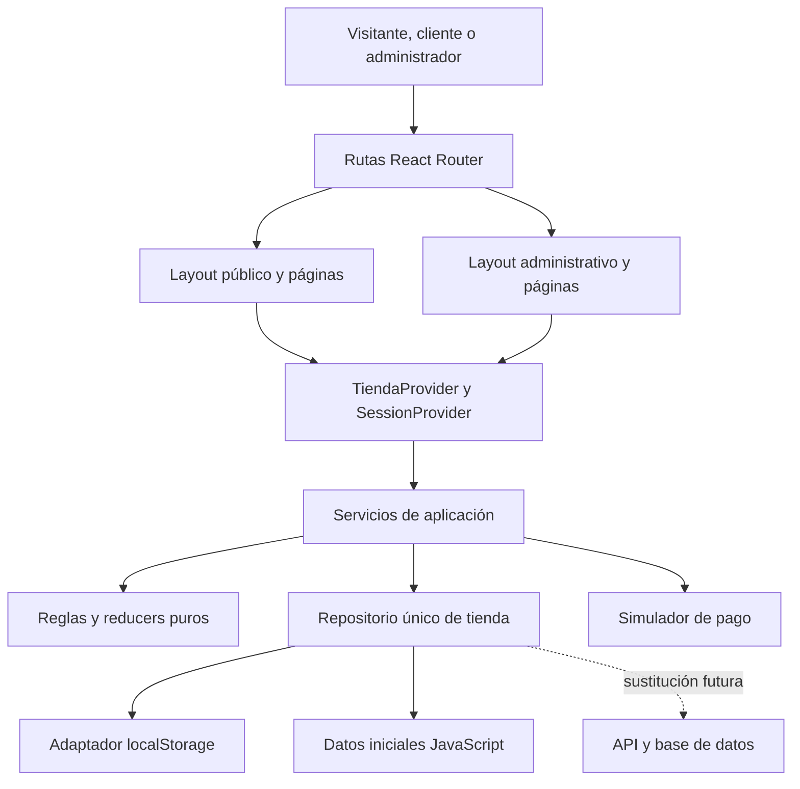
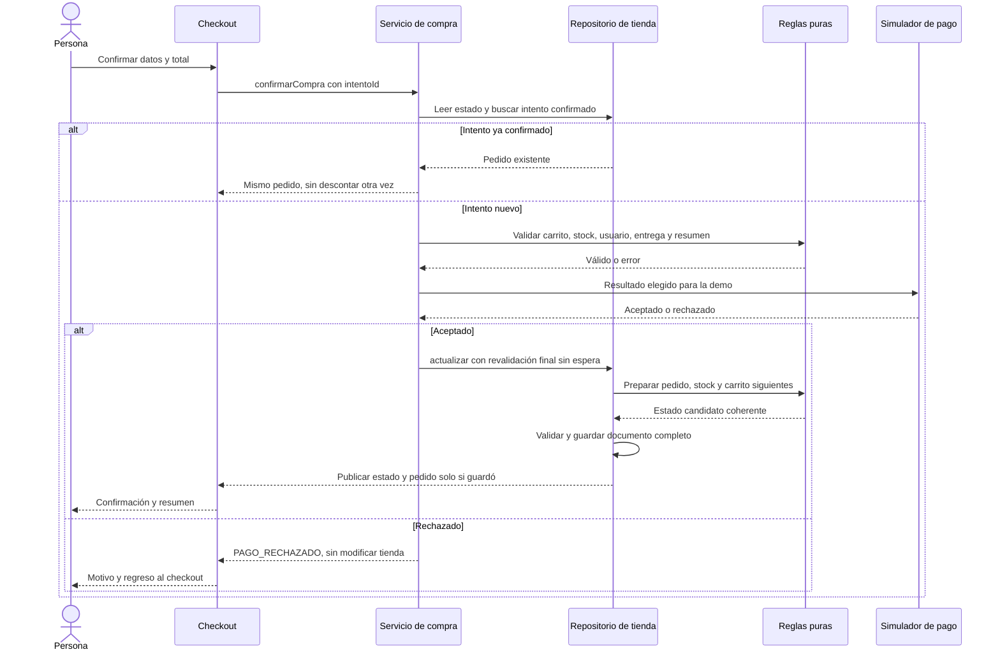

# Arquitectura de Boost Level para EP2

**Versión:** 0.3 · **Fecha:** 25-10-2026  
**Estado:** arquitectura implementada en `ProyectoFull/Boost-Level-/frontend/`, pendiente de revisión del equipo.  
**Integrantes:** Jordán Guzmán Parra, Mario Tepe Espinoza y Luis Contreras Gonzalez.

La aplicación es una SPA React con datos JavaScript y persistencia local. Catálogo y administrador comparten inventario; carrito y checkout utilizan esa misma información. El diseño responde a los fallos de stock y compra de EP1 y conserva sus recursos visuales.

## 1. Ubicación y herramientas

```text
Boost-Level-/
  index.html, admin/, js/, css/, img/   # EP1 conservada como referencia
  frontend/                           # paquete React implementado
    package.json, package-lock.json
    index.html, vite.config.js
    public/img/                       # copia de recursos utilizados
    src/
  docs/ep2/                           # especificación y seguimiento
  README.md                           # acceso EP1 y estado EP2
```

`clase-tienda-react/` sigue siendo un repositorio independiente de referencia. No copiar su carpeta `.git`, `node_modules`, lockfile sin revisión ni sus cambios pendientes sobre el repositorio principal.

La base técnica usa React/React DOM, Vite y su plugin React, Bootstrap/React Bootstrap, React Router, Oxlint, Vitest, Testing Library, jsdom y V8. Las versiones exactas están fijadas en package.json y package-lock.json; Node/npm están registrados en README e informe. Vitest y `@vitest/coverage-v8` usan la misma versión 5.0.5. La presencia de `@types` en el ejercicio de clase no lo convierte en TypeScript.

## 2. Capas y propiedad del estado



| Parte | Responsabilidad |
|---|---|
| Páginas/componentes | Presentación, navegación y eventos. Reciben datos/callbacks; campos y filtros usan estado local. |
| TiendaProvider | Comparte el estado confirmado de productos, categorías, usuarios, carrito y pedidos con useState. useEffect suscribe los cambios guardados por el repositorio y limpia la suscripción al desmontar. |
| SessionProvider | Mantiene el ID de usuario demo, relee rol/estado desde tienda y persiste sesión en sessionStorage. No posee otra copia del catálogo/carrito. |
| Servicios | Orquestan lectura, validación, comandos, pago simulado, persistencia y notificación del estado confirmado a React. |
| Dominio | Cálculos y transiciones puras: mismas entradas producen mismas salidas; no consulta storage, DOM ni reloj. Recibe productos, usuario, fecha e ID cuando corresponda. |
| Repositorio | Una instancia por aplicación. Lee/valida el documento, administra revisión y persiste actualizaciones completas. CRUD son operaciones sobre ese documento. |
| Adaptadores | Serialización y acceso al almacenamiento; reloj/IDs y simulador de pago inyectables en pruebas. |

Las reglas de cantidad están en `carrito.reducer.js`, que recibe líneas y una acción con los datos necesarios del producto. El servicio lee el producto y construye la acción antes de llamarlo. **El reducer nunca lee el repositorio ni escribe persistencia.** Es una función pura JavaScript; la aplicación no usa el hook useReducer. La actualización inmutable sigue el ejemplo de clases con find/map/filter.

## 3. Estructura del código

Árbol resumido del código implementado. Cada página y componente JSX tiene su propio archivo y exportación por defecto, siguiendo las guías de clase. Las llaves enumeran archivos; no representan carpetas literales.

```text
frontend/src/
  main.jsx                    # BrowserRouter, estilos y providers
  App.jsx                     # Routes/Route y páginas
  App.test.jsx                # pruebas de componentes e integración
  contexto/
    {TiendaProvider,SessionProvider}.jsx
    {TiendaContext,SesionContext}.js
  hooks/useApp.js
  componentes/
    layout/{Layout,AdminLayout}.jsx
    catalogo/{TarjetaProducto,GrillaProductos}.jsx
    catalogo/{TarjetaProducto,GrillaProductos}.test.jsx
    carrito/LineaCarrito.jsx
    formularios/{UsuarioForm,Direccion}.jsx
    navegacion/RutaAdmin.jsx
    pedidos/Comprobante.jsx
    administracion/{Estado,BajaButton,Tabla}.jsx
    contenido/BlogCards.jsx
    ui/{Campo,Confirmacion,ErrorMensaje,FotoProducto,Icono,
        NoEncontrado,PageTitle,Resumen,Vacio}.jsx
  paginas/
    {InicioPage,CatalogoPage,CategoriasPage,DetallePage}.jsx
    {CarritoPage,CheckoutPage,CompraExitosaPage,CompraRechazadaPage}.jsx
    {LoginPage,RegistroPage,NosotrosPage,BlogsPage,ArticuloPage,ContactoPage}.jsx
    admin/
      {DashboardPage,ProductosPage,ProductoFormPage,ProductoDetallePage}.jsx
      {CategoriasAdminPage,UsuariosPage,UsuarioFormPage,UsuarioDetallePage}.jsx
      {PedidosPage,PedidoDetallePage,CriticosPage,PerfilPage}.jsx
  domain/
    {carrito.reducer,compra.rules,precios,validaciones,esquema,errores}.js
    dominio.test.js
  services/{tienda.service,sesion.service,servicios.test}.js
  repositories/{tienda.repository,storage.adapter}.js
  data/{productos,categorias,usuarios.demo,regiones,blogs,inicial}.js
  utils/moneda.js
  test/{setup,factories}.js
  test/renderApp.jsx
  styles.css
```

TarjetaProducto y GrillaProductos reciben datos y callbacks por props. CatalogoPage e InicioPage conectan las acciones con servicios y estado compartido. El enlace de detalle se entrega a la tarjeta como prop, sin que esta construya una ruta de producto propia.

El estado usa useState y una suscripción mediante useEffect; el carrito conserva una función reducer pura. La orquestación está en services/tienda.service.js; dominio y repositorio mantienen sus responsabilidades. Context y estos módulos son decisiones adicionales explicadas en la [guía de código](08_GUIA_EXPLICACION_CODIGO.md).

Se usa BrowserRouter, como en FullStack II. Vite toma la base desde VITE_BASE_PATH o /, y el router utiliza import.meta.env.BASE_URL como basename. public/_redirects prepara el fallback de la SPA para un alojamiento compatible. La publicación real del sitio y el fallback del alojamiento elegido requieren verificación aparte.

## 4. Modelo de datos

Todos los importes son números enteros CLP. Fechas de pedido se guardan en ISO; fechas de nacimiento como `YYYY-MM-DD`, sin convertirlas a un instante UTC para calcular edad.

| Entidad | Campos |
|---|---|
| Producto | id, codigo, categoriaId, nombre, descripcion, precio, precioOferta (null o entero), imagen, stock, umbralCritico (null o entero), activo |
| Categoria | id, nombre, activo |
| UsuarioDemo | id, run, nombre, apellidos, correo, fechaNacimiento, claveDemo, regionId, comunaId, direccion, rol (cliente/admin), activo |
| LineaCarrito | productoId, cantidad |
| Pedido | id, intentoId, creadoEn, clienteId (null para invitado), contacto, entrega, lineas, subtotal, descuento, costoEntrega, total, estado (CONFIRMADO) |
| LineaPedido | productoId, codigo, nombre, precioLista, precioUnitario, cantidad, subtotal |
| Entrega | modalidad (domicilio/retiro), regionId, comunaId, direccion, costo |

El pedido conserva una instantánea de nombre, precios, contacto y entrega. La baja lógica de producto/usuario mantiene referencias y comprobantes históricos. Los rechazos del simulador se representan como resultado de intento, no como pedidos confirmados.

`claveDemo` permite cumplir registro→login con datos locales exclusivamente ficticios. Este mecanismo no protege credenciales. La aplicación identifica explícitamente las cuentas como demo y no pide contraseñas o información bancaria reales.

### Importación de EP1

- `id` de producto = `codigo` original; conservar los once códigos y cantidades.
- Crear categorías estables a partir de los nueve nombres distintos del catálogo.
- Copiar imágenes utilizadas a `frontend/public/img/`; resolverlas con la base Vite para admitir alojamiento bajo subruta.
- Importar productos sin ofertas (`precioOferta: null`) y sin umbral crítico inventado (`umbralCritico: null`).
- Mantener los dos accesos demo conocidos: admin@duoc.cl/1234 y usuario@gmail.com/1234. Completar perfiles solo con datos identificados como ficticios.
- Los datos de nacimiento/RUN no existentes en las cuentas heredadas se pueden marcar como null; registro y alta nueva sí validan todos sus campos.
- Nuevo namespace de persistencia; no importar automáticamente la clave EP1 sin validar su esquema.

## 5. Persistencia y contrato de datos

Documento único con clave `boostLevel:tienda:v1`:

```text
{
  schemaVersion: 1,
  revision: 0,
  productos: [],
  categorias: [],
  usuarios: [],
  carrito: [],
  pedidos: []
}
```

La sesión usa `boostLevel:sesion:v1` en `sessionStorage`, con `usuarioId`. Región/comuna y blogs son catálogos de solo lectura en archivos JS.

| Operación | Entrada / salida |
|---|---|
| crearRepositorio() / getSnapshot() | Inicializa estado validado; clave ausente usa datos JS. Si existe pero es inválida, comunica error recuperable y no la sobrescribe silenciosamente. getSnapshot entrega el estado confirmado para React. |
| leerEstado() | Copia del estado confirmado; consumidores no lo mutan directamente. |
| actualizar(transformar) | Recarga estado vigente, calcula candidato de forma sincrónica, valida esquema/invariantes, incrementa revisión y escribe una sola clave. Solo después publica el candidato en memoria/React. |
| useApp.reset() / repositorio.restablecer() | Tras confirmación explícita, cierra sesión y reemplaza tienda por estado inicial. Si falla acceso, muestra error. |
| CRUD | crear/editar/desactivar producto, categoría o usuario, siempre a través de actualizar; conserva referencias históricas. |

Los módulos pueden devolver promesas para preparar una futura API, pero el cálculo y guardado final local no deben contener `await` entre lectura y escritura. Leer la revisión nuevamente después del pago simulado. Una escritura que falla deja el estado confirmado anterior y no informa éxito.

Resultado común:

```text
{ ok: true, data }
{ ok: false, error: { codigo, mensaje, campos? } }
```

Los códigos distinguen validación, producto ausente, stock, cambio de precio, duplicado, permisos, rechazo del pago, persistencia y esquema inválido. Los valores efectivos y los resultados se comprueban en las pruebas de dominio/servicios.

Un único `setItem` agrupa pedido, stock y carrito y evita que cada entidad se guarde por separado. Esta decisión mejora consistencia local, pero no resuelve concurrencia entre pestañas ni transacciones de servidor; esa garantía queda fuera del alcance.

## 6. Contratos de interacción

| Elemento | Contrato |
|---|---|
| TarjetaProducto | producto, categoria, cantidadEnCarrito, onAgregarProducto(productoId). La tarjeta pasa el ID exacto una vez por clic. |
| LineaCarrito | linea (producto, productoId, cantidad, precio, subtotal, error), onCambiarCantidad(productoId,cantidad), onEliminar(productoId). Cantidad solicitada absoluta. |
| CheckoutPage | resumen vigente y datos de sesión; mantiene campos, modalidad e intentoId localmente; llama confirmarCompra. |
| confirmarCompra | {intentoId, contacto, entrega, resultadoSimulado, resumenAceptado}. Devuelve pedido guardado o error con código. |
| Formularios admin | ID cuando edita, valores iniciales y acción guardar; validaciones de dominio/repository son autoritativas para la demo. |
| Historial y reportes | Selectores derivados del estado confirmado, sin contadores persistidos adicionales. |

`resumenAceptado` representa precios vigentes, elegibilidad/descuento y total mostrados al confirmar. Si alguno cambió, devolver `PRECIO_CAMBIO`, mostrar nuevo resumen y pedir nueva confirmación; nunca aceptar silenciosamente un importe distinto.

## 7. Compra simulada



El rechazo por validación termina antes del simulador. La revalidación final ocurre incluso si el simulador aceptó. La UI usa botón deshabilitado mientras procesa y un bloqueo sincrónico del handler; el servicio busca `intentoId` en pedidos antes de mutar. Un mismo intento confirmado sobrevive a recarga. Un nuevo pedido recibe un nuevo intentoId. Tests inyectan reloj, generador de IDs y simulador para resultados deterministas.

## 8. Rutas

Se usa modo declarativo con `BrowserRouter`, montado en main.jsx, y rutas como `/productos/JM001`. Routes/Route están en App.jsx; las páginas y componentes tienen archivos separados. La verificación de recarga se registra junto a las evidencias; el alojamiento público sigue pendiente.

| Ruta lógica | Vista |
|---|---|
| / | Inicio |
| /productos, /productos/:id | Catálogo y detalle |
| /categorias, /categorias/:id, /ofertas | Categorías, filtro por categoría y ofertas |
| /carrito, /checkout | Carrito y datos de entrega |
| /compra/rechazada | Resultado de intento; sin datos de pago en URL |
| /compra/exitosa/:pedidoId | Resumen del pedido confirmado; ID inexistente maneja no encontrado |
| /login, /registro | Cuentas demo |
| /nosotros, /blogs, /blogs/:slug, /contacto | Contenido heredado |
| /admin | Dashboard |
| /admin/productos, /admin/productos/nuevo, /admin/productos/:id, /admin/productos/:id/editar | CRUD productos |
| /admin/categorias | CRUD categorías |
| /admin/usuarios, /admin/usuarios/nuevo, /admin/usuarios/:id, /admin/usuarios/:id/editar | CRUD clientes e historial en detalle |
| /admin/pedidos, /admin/pedidos/:id | Pedidos y comprobante |
| /admin/criticos, /admin/reportes, /admin/perfil | Críticos, reportes y perfil |

IDs/slugs desconocidos muestran estado no encontrado y regreso. Las guardas verifican sesión, rol y estado activo tanto en navegación como en comandos de administración. El comprobante demo no constituye autorización de producción.

## 9. Justificación y referencias técnicas

| Decisión | Razón | Referencia |
|---|---|---|
| Componentes/props | Separar presentación y acciones verificables, como en la tarjeta de clase. | [React: compartir estado](https://react.dev/learn/sharing-state-between-components) |
| Reducers puros y Context | Centralizar transiciones y compartir estado entre vistas sin escrituras desde render/reducer. | [React: reducer y Context](https://react.dev/learn/scaling-up-with-reducer-and-context), [useReducer](https://react.dev/reference/react/useReducer) |
| Router declarativo | URLs y parámetros explícitos para nuevas vistas. Verificar contra versión fijada, sin actualizar por copia de la documentación latest. | [React Router](https://reactrouter.com/start/declarative/routing) |
| Grilla Bootstrap | Adaptación móvil/tablet/escritorio con marca propia. | [Bootstrap breakpoints](https://getbootstrap.com/docs/5.3/layout/breakpoints/) |
| Pruebas sobre UI y reglas | Render/eventos reales, providers en helper de render y dependencias controlables. | [Testing Library](https://testing-library.com/docs/react-testing-library/setup/) |
| Include y umbrales de cobertura | Medir también código no importado por tests y obtener reporte reproducible. | [Vitest coverage](https://vitest.dev/guide/coverage.html), [configuración](https://vitest.dev/config/coverage) |
| Alcance local explícito | Datos de un origen persistidos en navegador; futura API reemplaza almacenamiento. | [MDN localStorage](https://developer.mozilla.org/en-US/docs/Web/API/Window/localStorage) |

## 10. Decisiones pendientes de contraste

La implementación sigue esta base. La guía docente S13 confirma el uso de Vitest para las pruebas. Quedan por contrastar con docente/equipo la frase aislada de integración con backend y las elecciones de negocio (descuento, ofertas, entrega gratuita demo). Cambios se registran en ERS, pruebas y matriz. La etiqueta “Editar usuario” dentro de categoría del diagrama S1 p. 10 se interpreta como “Editar categoría” en esta propuesta.

La referencia S10 se aplica con BrowserRouter y separación de páginas/componentes. La [correspondencia docente](09_CORRESPONDENCIA_GUIAS_CLASE.md) identifica los conceptos enseñados y las decisiones adicionales, sin atribuir Context, servicios o consistencia de compra al ejemplo de clases.
