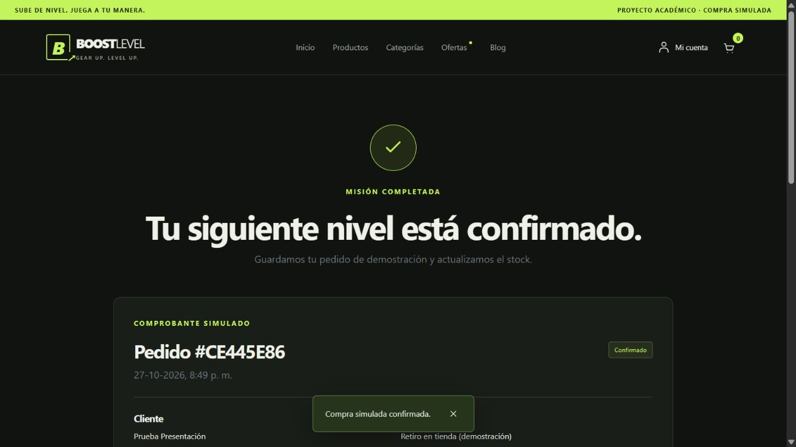

# Revisión para la presentación de Boost Level

**Fecha:** 29-10-2026. Revisión final de código, pruebas y recorrido HTTP local. **Asignatura:** DSY1104. **Docente:** Víctor Hugo Gómez Atabales. **Entrega:** 29-10-2026.  
**Integrantes:** Jordán Guzmán Parra, Mario Tepe Espinoza y Luis Contreras Gonzalez.

El frontend está implementado y supera las comprobaciones técnicas locales. Las pantallas del anexo están presentes; no hace falta aumentar el catálogo de once productos para cumplir ese alcance. El equipo confirmó que el profesor exige solo frontend. La actualización final de la instancia AWS Academy / Learner Lab ya está comprobada públicamente. Quedan la revisión cruzada de documentos y el ensayo de la exposición.

## Fuentes contrastadas

Se revisaron las instrucciones EP2, páginas 1 a 12, sus diagramas públicos y administrativos (páginas 3, 4 y 10), la pauta estudiantil y sus indicadores de páginas 6 a 9, las instrucciones de las plantillas Word/Excel y sus copias completadas. También se contrastaron el ejercicio clase-tienda-react, las guías React y Router de FullStack II, las diapositivas de React y la [guía de pruebas del profesor](https://vihgo.github.io/repaso-dsy1104-2026/#guia-pruebas). Los originales permanecen conservados.

La revisión del código abarca rutas, componentes, páginas públicas/administrativas, datos iniciales, formularios, reglas, servicios, persistencia, estilos, configuración y los cinco archivos de prueba. Las pantallas se recorrieron sobre el paquete compilado con Vite preview. Los resultados visibles y dimensiones constan en [revision-presentacion.json](evidencias/revision-presentacion.json).

## Contraste con la rúbrica

| Indicador grupal | Evidencia local | Estado técnico |
|---|---|---|
| Estructura y uso del framework (10%) | main.jsx, App.jsx, páginas/componentes separados, datos JavaScript y persistencia local | Implementado |
| Componentes, props, estado y diseño adaptable (10%) | TarjetaProducto/GrillaProductos, formularios controlados, useState, Bootstrap y recorridos a 375/768/1280 | Verificado localmente |
| Diez pruebas estructuradas de componentes (12%) | 23 casos de componentes/interfaz; diez seleccionados en plan, sección 4 | Supera el número solicitado; ensayo pendiente |
| Proceso, configuración, mocks y cobertura (8%) | Vitest/RTL/jsdom/V8, vi.fn, aislamiento, logs, hashes y cuatro métricas sobre 80% | Verificado localmente |

El 60% individual evalúa las explicaciones y demostraciones de cada integrante. Los archivos preparados no acreditan que cada persona ya pueda responder. Todos deben explicar diseño, props/estado, formularios, pruebas, mocks y cobertura; la guía de estudio está en [08](08_GUIA_EXPLICACION_CODIGO.md).

## Pantallas y funcionamiento

| Grupo del diagrama | Correspondencia comprobada |
|---|---|
| Tienda | Inicio, catálogo, detalle por ID, categorías y catálogo por categoría, ofertas |
| Cuenta y contenido | Registro, login/logout, nosotros, blogs, dos artículos y contacto simulado |
| Compra | Carrito, checkout, rechazo, reintento, comprobante confirmado y recarga del pedido |
| Administración | Resumen/reportes, productos (alta/detalle/edición/baja), categorías (alta/edición/baja), usuarios (alta/detalle/edición/baja), historial, pedidos/detalle, críticos y perfil |

El formulario de categorías y su edición comparten pantalla; el historial está en el detalle del usuario y los reportes reutilizan el resumen. Son funciones presentes con una organización propia del proyecto.

El recorrido de compra aceptó cantidad 15 y rechazó 16 sin alterar el importe; luego se compró una unidad de Catan por $29.990 con datos ficticios y retiro. El rechazo conservó el carrito; el reintento aceptado dejó stock 14 y carrito vacío. El comprobante sobrevivió a la recarga y administración mostró un pedido y ventas por $29.990. Configurar oferta de $25.000 y umbral 15 actualizó ofertas y críticos sin cambiar el precio histórico del pedido. Después se retiró la oferta de prueba y se restablecieron únicamente los datos del navegador usado para la revisión.

También se comprobó el filtro por categoría, las rutas inexistentes de producto/artículo/página, el menú móvil con Enter, el salto al contenido con foco visible y el diálogo con Tab, Shift+Tab, Escape y retorno de foco. No se observaron errores ni advertencias de consola en ese recorrido. Esto es una revisión local parcial de accesibilidad; no sustituye la revisión de otra persona.

## Correcciones realizadas

Se corrigieron dos líneas de CSS: el color secundario de Bootstrap ahora coincide con el color legible de la interfaz y la tabla administrativa permite desplazamiento horizontal interno. Catálogo, carrito, checkout y productos administrativos caben en los tres anchos revisados; no se encontraron imágenes rotas en esos controles.

La instalación inicial detectó avisos en Vite 8.3.0. Se fijó Vite en 8.3.5, conservando React, Vitest y las reglas de negocio. La nueva auditoría de dependencias no detectó avisos; es el resultado de esa comprobación, no una garantía general de seguridad. Referencias: [versión oficial 8.3.5](https://github.com/vitejs/vite/releases/tag/v8.3.5) y [registro npm audit](evidencias/dependencias.json).

Se completó el historial de versiones del Word de cobertura sin retirar entradas anteriores y se relacionaron explícitamente los 34 elementos no cubiertos con los riesgos residuales. La escala conserva Baja/Media/Alta. Las firmas, la revisión cruzada y la evaluación docente siguen pendientes.

## Pruebas y paquete

| Comprobación | Resultado |
|---|---|
| Formato y lint | Aprobados |
| Suite completa | 33 aprobadas, cero fallos/omitidas/pendientes, cinco archivos |
| Cobertura global | 93,12% sentencias; 90,46% ramas; 94,32% funciones; 94,22% líneas |
| Alcance de cobertura | 72 archivos productivos; mismos umbrales del 80% y exclusiones justificadas |
| Compilación de producción | Correcta con Vite 8.3.5 |
| Auditoría de dependencias | Cero avisos en la comprobación registrada |
| Extracción e instalación del paquete final | Extracción nueva del ZIP final: npm ci correcto, cero avisos, build correcto. Sus 25 archivos compilados coinciden byte por byte con dist/ del proyecto principal. |

La [corrida final y su duración](06_INFORME_COBERTURA_BORRADOR.md) se documentan con JSON, log y manifiesto de 110 fuentes. Las capturas HTML, coverage.zip y Word corresponden a esa misma medición. Los recorridos manuales no añaden pruebas ni cambian porcentajes. Las alternativas sin respaldo automatizado permanecen en la matriz y en la sección 6.2 del informe.

Las copias académicas están en Documentacion_DSY1104_EvaluaciónParcial2/Completadas_Boost_Level_EP2: ERS V2, informe de cobertura 0.11, planilla con 22 RF/10 RNF, coverage.zip y Boost_Level_EP2_fuentes.zip. El paquete fuente conserva README, lockfile, imágenes, frontend y documentación; excluye .git, node_modules, dist y cachés. Ejecutar npm ci y npm run dev dentro de frontend, como indica su README.

## Cierre técnico del 29 de octubre

Se conservó crearId en utils/identificador.js y se comprobó el checkout sin crypto.randomUUID. La página Ofertas muestra cuatro productos existentes: AC001 59.990 → 47.992 (20%), AC002 139.990 → 111.992 (20%), CO001 549.990 → 494.991 (10%) y MS001 169.990 → 135.992 (20%). La actualización adapta una sola vez los datos anteriores sin borrar carrito ni pedidos; una oferta retirada por administración permanece retirada tras recargar.

El recorrido final se ejecutó sobre el build de producción por HTTP local el 29-10-2026. Se conservó un carrito anterior, se añadió una oferta y se completó una compra ficticia de $77.982. El rechazo mantuvo las dos unidades; el reintento confirmado vació el carrito y guardó el comprobante, que sobrevivió a la recarga. Productos, Categorías, Ofertas, Blog, Nosotros, Carrito y Checkout cargaron sin imágenes rotas ni errores de consola. Ofertas también se revisó a 375 px.

Registro: [recorrido-final-http.json](evidencias/recorrido-final-http.json). Las capturas con sufijo final-http y movil-http corresponden a ese origen local; no son evidencia pública de AWS. La evidencia AWS del 28 de octubre se conserva como histórica.

## Pendientes del equipo antes de entregar

1. Revisar en conjunto los Word y el Excel y ensayar los diez casos seleccionados. Registrar firmas solo después de realizar esa revisión.

GitHub main está sincronizado con el código, la documentación y las evidencias AWS actualizadas. La aplicación pública se verificó el 29-10-2026. La dirección es dinámica y el equipo se la comunicará directamente al profesor el día de la presentación.

El resultado no acredita pagos reales, autenticación de servidor ni aprobación docente.
